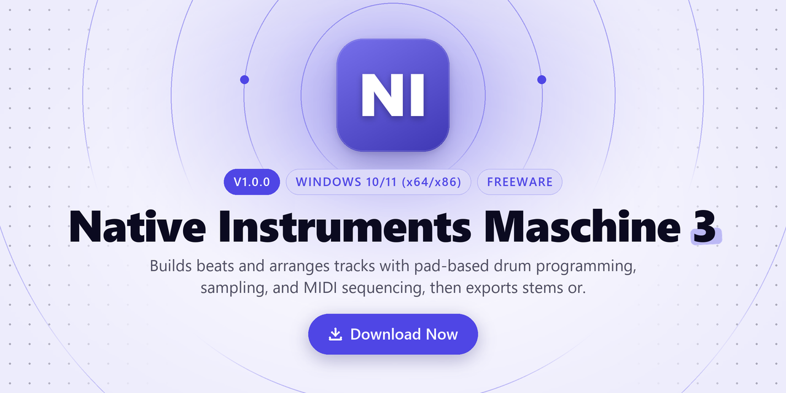

<h1 align="center">Native Instruments Maschine 3 - Beat Production and MIDI Sequencing Workstation on Windows 10/11</h1>

<p align="center"><i>Maschine 3 is Native Instruments' pad-based groove production and arrangement environment for Windows, pairing the Maschine controller with a sampling, drum programming, and MIDI sequencing engine. This page documents requirements, folder layout, controller shortcuts, CLI helpers, and fixes for common Windows issues.</i></p>

<p align="center">&nbsp;&nbsp;&nbsp;&nbsp;&nbsp;&nbsp;&nbsp;&nbsp;</p>

<p align="center"></p>

<p align="center">
  <a href="https://ruigrigoriev.github.io/native-instruments-maschine-3/">
    <picture>
      <source media="(prefers-color-scheme: dark)" srcset="./assets/Click-dark.svg">
      
    </picture>
  </a>
</p>

<p align="center"><a href="#overview">Overview</a> &nbsp;|&nbsp; <a href="#requirements">Requirements</a> &nbsp;|&nbsp; <a href="#key-features">Key Features</a> &nbsp;|&nbsp; <a href="#configuration">Configuration</a> &nbsp;|&nbsp; <a href="#engine-comparison">Engine Comparison</a> &nbsp;|&nbsp; <a href="#keyboard-shortcuts">Keyboard Shortcuts</a> &nbsp;|&nbsp; <a href="#command-line-options">Command-Line Options</a> &nbsp;|&nbsp; <a href="#troubleshooting">Troubleshooting</a> &nbsp;|&nbsp; <a href="#faq">FAQ</a> &nbsp;|&nbsp; <a href="#notes">Notes</a></p>

## Overview

Maschine 3 runs as a standalone host or as a plugin inside a DAW, driven by the Maschine hardware surface or by mouse and keyboard. This section summarizes the shipped build and its role in a Windows production setup.

### What It Does

The application combines a step sequencer, sampler, slicer, and MIDI sequencer in a single scene and pattern grid. Groups route to a mixer with per-pad inserts, and Arranger mode converts performed patterns into linear song structure before export.

### Who It Is For

Beat makers, hip-hop and electronic producers, and live performers who want pad-first workflow without leaving the controller. It also suits DAW users who load Maschine as a VST3 or AAX instrument for sketching ideas before transferring stems.

### What Ships in the Build

The Windows installer delivers the standalone application, VST3 and AAX plugin builds, the Maschine 3 factory library, and the Native Access integration for additional content and updates. The controller firmware utility is bundled separately in the installer payload.

## Requirements

| Spec | Minimum | Recommended |
|------|---------|-------------|
| OS | Windows 10 22H2 (64-bit) | Windows 11 23H2 or later |
| CPU | Intel Core i5 or AMD Ryzen 5, 4 cores | Intel Core i7 or AMD Ryzen 7, 8 cores |
| RAM | 8 GB | 16 GB or more |
| GPU or display | 1280x800, DirectX 11 capable | 1920x1080 or higher, dedicated GPU |
| Storage | 20 GB free for application and library | 100 GB free SSD for samples and projects |
| Audio interface | Any Windows WDM or WASAPI device | ASIO 2.0 interface with dedicated driver |

## Key Features

* **Pad-Based Drum Programming** , triggers 16 velocity-sensitive pads mapped to a kit, with per-pad tuning, filtering, and choke groups.
* **Sampling and Slicing** , records internal or external audio and slices it across pads with transient detection.
* **Pattern and Scene Sequencing** , arranges patterns into scenes and chains scenes into a linear song in the Arranger.
* **MIDI Sequencing** , routes MIDI from hardware controllers and external synths to internal groups or plugin slots.
* **Stem Export** , renders individual groups, pads, or the master bus to WAV with configurable bit depth and tail length.
* **Controller Integration** , maps the Maschine hardware screens, encoders, and transport directly to host parameters.
* **Plugin Hosting** , loads VST3 and AAX instruments and effects on pads, groups, and the master.
* **Live Set Mode** , performs scenes, pattern retriggering, and effect sweeps without stopping playback.

## Configuration

| Path | Purpose |
|------|---------|
| `%LOCALAPPDATA%\Native Instruments\Maschine 3` | Per-user application cache, browser index, and waveform previews |
| `%APPDATA%\Native Instruments\Maschine 3` | User preferences, keybind assignments, and recent project list |
| `%PROGRAMDATA%\Native Instruments\Maschine 3` | Shared factory content registration and controller firmware manifests |
| `%PROGRAMFILES%\Native Instruments\Maschine 3` | Application binaries, plugin builds, and bundled resources |
| `%LOCALAPPDATA%\Native Instruments\Native Access` | License activation state and download cache for libraries |
| `%USERPROFILE%\Documents\Maschine 3` | Default project folder and exported stems |

| Setting | Default | Notes |
|---------|---------|-------|
| Audio driver | WASAPI shared | Switch to ASIO for low-latency monitoring and multi-output |
| Buffer size | 512 samples | Lower to 128 or 256 on ASIO hardware for live performance |
| Sample rate | 44100 Hz | Match the interface clock to avoid resampling on export |
| Auto-update channel | Stable | Options are Stable and Beta under Native Access settings |
| Controller auto-detect | On | Disable when running multiple Maschine controllers on one host |
| Default export format | WAV 24-bit | Change to 16-bit or AIFF in Preferences > Export |
| Telemetry / usage data | On | Toggle in Preferences > Privacy to stop anonymous usage reporting |

## Engine Comparison

| Parameter | Standalone Mode | Plugin (VST3) Mode | Hardware Controller Mode |
|-----------|-----------------|--------------------|--------------------------|
| Routing | Internal mixer and master bus | Host mixer and DAW routing | Internal mixer, transport slaved to controller |
| CPU overhead (idle project) | 4 to 7 percent | 6 to 10 percent plus host cost | 5 to 9 percent |
| Latency (128 buffer, ASIO) | 2.9 ms | 2.9 ms plus host chain | 2.9 ms |
| Multi-output channels | Not applicable | Up to 16 stereo pairs | Not applicable |
| Best for | Sketching and live sets | Finishing inside a DAW | Pad-first performance and recording |

## Keyboard Shortcuts

| Action | Shortcut |
|--------|----------|
| Play or pause transport | Space |
| Start recording | Shift + Space |
| Toggle Arranger and Ideas view | Tab |
| Duplicate current pattern | Ctrl + D |
| Quantize selected events | Ctrl + Q |
| Toggle metronome | Shift + M |
| Open plugin browser | F1 |
| Open sampler editor | F2 |
| Export audio or stems | Ctrl + Shift + E |
| Reset all controller pads | Shift + Ctrl + R |

## Command-Line Options

| Flag | Argument | Purpose |
|------|----------|---------|
| `--project` | file path | Opens a `.mxprj` project at launch instead of the last used file |
| `--audio-device` | device name | Forces a specific ASIO or WASAPI device for the session |
| `--buffer` | integer (samples) | Overrides the saved buffer size at startup |
| `--samplerate` | integer (Hz) | Forces sample rate; must match the audio interface clock |
| `--safe-mode` | none | Loads with plugins disabled to isolate a crash on startup |
| `--export-stems` | output folder | Renders group stems headlessly and exits |
| `--controller` | model ID | Binds a specific Maschine hardware model if multiple are attached |
| `--log-level` | info, debug, trace | Sets diagnostic logging verbosity for the session |

```
Maschine3.exe --project "D:\Sessions\demo.mxprj" --audio-device "ASIO:Focusrite USB ASIO" --buffer 128 --log-level debug
```

| Exit Code | Meaning |
|-----------|---------|
| 0 | Normal exit or export completed |
| 1 | Project file not found or failed to parse |
| 2 | Requested audio device unavailable |
| 3 | License check failed, activation required |
| 4 | Stem export aborted by plugin error |

## Troubleshooting

### Controller Not Recognized After Windows Update

The Maschine hardware stops responding and the controller screen stays on the splash image.
1. Open Device Manager and confirm the controller appears under Sound, video and game controllers.
2. Disconnect and reconnect the controller to a rear USB port, avoiding hubs.
3. Run the controller firmware utility from `%PROGRAMFILES%\Native Instruments\Maschine 3` and reflash the device.
4. Restart the application and verify the controller model under Preferences > Controller.

### Clicks and Crackles During Playback

Audio stutters or pops during dense patterns, especially with external plugins loaded.
1. Switch the audio driver from WASAPI to the interface's ASIO driver.
2. Raise the buffer size to 256 or 512 samples and retest.
3. Disable Windows power throttling in Settings > System > Power and set the power plan to High performance.
4. Freeze or resample CPU-heavy plugin slots on pads and groups.

### Stem Export Produces Silence

Rendered stems contain no audio though playback is audible.
1. Confirm the group or pad is routed to the master and not to an unassigned output.
2. In the export dialog, check that the tail length is greater than zero for reverb and delay tails.
3. Verify the output folder path does not contain characters outside the Windows default code page.
4. Regenerate stems in `--safe-mode` to rule out a misbehaving plugin on the master.

### High DPI Scaling Blurs the Interface

The plugin window appears fuzzy on a 4K display or when dragged between monitors.
1. Right-click `Maschine3.exe`, open Properties, then Compatibility.
2. Set Override high DPI scaling behavior to Application.
3. Restart the application and log out of Windows if the change does not apply immediately.
4. In a DAW host, enable per-monitor DPI awareness in the host preferences.

## FAQ

### Can Maschine 3 run as a plugin inside Ableton Live or FL Studio on Windows?

Yes, the installer registers both VST3 and AAX builds. In a VST3 host, point the plugin scan at `%PROGRAMFILES%\Common Files\VST3` and load Maschine 3 as an instrument, then route its multi-outputs to host tracks for stem-style mixing.

### Does the hardware controller work without the Maschine 3 software running?

The controller enumerates as a class-compliant MIDI device, but its screens, encoders, and transport only function with the Maschine 3 application or plugin host active. You can map its pads as generic MIDI in other software, with limited feedback.

### How do I move a project and its samples to another Windows machine?

Use File > Save with Samples to bundle referenced audio into the project folder, then copy the folder to the target machine. Install any missing factory libraries through Native Access first, so the browser resolves content paths on load.

## Notes

Maschine, Native Instruments, and Native Access are trademarks of Native Instruments GmbH. This page documents the Windows build of Maschine 3 for reference by administrators and power users; feature availability follows the shipped version and licensed content.